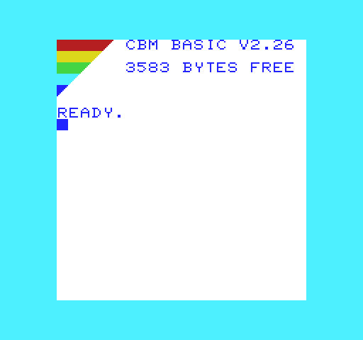

# Soopah-Rom-Vic20Enhanced

**Soopah ROM V2.26** provides commented, address-preserving corrections for the
Commodore VIC-20 BASIC 901486-01 and PAL KERNAL 901486-07 ROMs.
V2.26 is this project's build identifier. The BASIC language and token set remain
standard Commodore BASIC V2.

The patched source builds to a 16 KB image at $C000-$FFFF. All 1,409 existing ROM
labels, the public KERNAL jump table and hardware vectors retain their addresses.
Both ROMs are patched. Helpers reuse spare ROM space and obsolete non-timing
padding. The startup banner reads `CBM BASIC V2.26`, starting at column six
(zero-based). One trailing space retains the original 22-byte banner field.
The default blue text, white
background and cyan border are retained.
The left-hand rainbow steps through widths of five, four, three, two and one
cells over five rows, using fifteen cells and the stock diagonal glyph.
The heading and memory count are aligned at column six, separated from the
rainbow by one clear column. READY appears on row six; typing starts on row
seven (zero-based), below the stripes. It uses the original character ROM and
native red, yellow, green, cyan and blue. The free-memory
figure is calculated normally; an unexpanded VIC-20 displays 3583 bytes free.



This preview is rendered from the ROM's tested startup screen memory, with
approximate RGB colours and a visible cursor blink phase.

## Corrections

### Experimental PAL/NTSC Pair

An **8 KB universal KERNAL** and matching 8 KB BASIC are available for testing.
Experiment 3 adds a blue PAL/NTSC label beneath the memory count without moving
the heading, rainbow, READY or typing rows. Both ROMs change: install the new pair.
Experiment 2 used verified shared-VIA writes to recover four usable ROM bytes;
simulated PAL/NTSC boot tests now cover ten expansion-memory layouts.
The stable PAL ROMs above are unchanged. Use both experimental images together;
do not mix them with the stable patched BASIC or KERNAL.
Experiments 1/2 remain downloadable; neither BASIC should be used with Experiment 3.

The universal build detects the video chip's raster timing, then selects the
regional screen origin, 60 Hz system timer and RS-232 constants. It retains the
bug fixes and stepped V2.26 screen. To fit, string collection uses the stock
mover rather than the stable build's self-copy speed-up. It reserves five bytes
of previously unused system RAM, without reducing BASIC's reported free memory.

See [the experimental build and VICE instructions](docs/wiki/Universal-Experimental.md)
and [GitHub prereleases](https://github.com/Soopahfly/Soopah-Rom-Vic20Enhanced/releases).
Simulated tests pass; VICE, physical machines and real serial devices remain
unverified. RS-232 interrupt setup is slower and needs particular attention.

### Stable PAL Corrections

1. **Tape filename overflow:** copy at most 187 characters into the 192-byte
   cassette buffer after its five-byte prefix. Longer names are truncated and the
   current filename length is updated. Names longer than 16 displayed characters
   remain supported.
2. **RS-232 transmit race:** write each queued byte before publishing its end
   pointer to the NMI consumer.
3. **RS-232 handshake inputs:** use user-port VIA $9110 rather than keyboard VIA
   $9120 in the transmit and OPEN checks.
4. **RS-232 status:** return the saved status before clearing it, preserving X/Y.
5. **RS-232 NUL input:** blocking input polls queue availability rather than
   rejecting zero-valued characters.
6. **VERIFY message:** identify direct commands using the execution pointer's high
   byte and suppress OK during program execution.
7. **BASIC VAL overflow:** restore the temporarily overwritten string-end byte
   before forwarding a conversion error, protecting program text such as a closing
   quote. Restore the execution pointer, original error vector and borrowed
   $FB-$FE scratch bytes on both exits. Custom error handlers still receive X's
   original error number. Ordinary numeric results and overflow errors are retained.
8. **BASIC string collection:** skip the byte-copy loop when a selected string is
   already in its final position. Descriptor handling and collection order are
   unchanged; the collector still repeatedly scans descriptors.

The assembly comments explain each correction. No permanent RAM is allocated and
BASIC's free-memory total is unchanged. VAL temporarily uses four additional stack
bytes plus helper call frames.

Routine-level emulation measured 73.19% fewer collector cycles for eight packed
200-byte strings and 38.52% fewer for 32 packed 128-byte strings. A fragmented
32-string example took 0.22% more cycles. These are sample collector timings, not
whole-program or hardware speed claims; short strings and fragmented heaps may
benefit little or incur comparison overhead.

## Files

| Location | Contents |
| --- | --- |
| `src/` | Complete commented assembly and linker configuration |
| `roms/` | Patched 8 KB BASIC and KERNAL, plus combined 16 KB image |
| `reference/` | Original disassembly, production ROMs and immutable regression fixtures |
| `scripts/build.mjs` | Portable build, address checks and published-ROM comparison |
| `tests/test_vic20.py` | Focused NMOS 6502 emulator tests |
| `tests/test_basic.py` | VAL regressions, collector equivalence and cycle samples |
| `verification/` | Build differences and test results |
| `CHANGELOG.md` | Changes and verification limits for V2.26 |

For an emulator's separate ROM settings, use `roms/kernal.901486-07-fixed.bin` for
KERNAL and `roms/basic.901486-01-fixed.bin` for BASIC. The combined
`roms/vic20-fixed.bin` places BASIC first and KERNAL second; it is not a single
8 KB replacement chip image. Install both patched ROMs together: the BASIC patches
call helpers in the patched KERNAL. Keep the original character ROM.

## Build And Test

### Selectable GitHub Actions Builds

Open [Build VIC-20 ROMs](https://github.com/Soopahfly/Soopah-Rom-Vic20Enhanced/actions/workflows/build-roms.yml)
and select **Run workflow**. Independently choose the fix bundle, rainbow and
V2.26 heading, or build all eight combinations. For fixes with a completely stock
screen, enable fixes and disable both screen choices. Everything off reproduces
production ROMs exactly. Automatic builds produce every combination.

Download the successful run's ROM artifact. Each labelled folder contains both
8 KB images, the combined image, a manifest and checksums. Keep the two images
from the same folder together. Artifacts expire after 90 days.

See [build choices](docs/wiki/Building-ROMs.md) and
[patch notes](docs/wiki/Patch-Notes.md), also published on the
[GitHub wiki](https://github.com/Soopahfly/Soopah-Rom-Vic20Enhanced/wiki).

The optional **universal_experimental** switch builds the universal test pair
as a separate artifact. It currently has fixes, rainbow and V2.26 enabled;
the eight selectable stable PAL combinations remain unchanged.

```sh
node scripts/build-variants.mjs --all
python tests/test_variants.py
node scripts/build-variants.mjs --fixes=true --rainbow=false --banner=false
```

Variant outputs go to `dist/`; the default ROMs in `roms/` are unchanged.
BASIC/KERNAL fixes stay together because their helpers share ROM space.
Rainbow builds use this aligned layout with either `CBM BASIC V2` or
`CBM BASIC V2.26`; framing stars are removed to avoid collisions.
With rainbow and heading disabled, the complete original screen is retained.

### Canonical Build

Install Node.js, Python and the cc65 assembler toolchain. Make `ca65` and `ld65`
available on PATH, or set the `CA65` and `LD65` environment variables to their
executable paths. From the repository root:

```sh
python -m pip install -r requirements-test.txt
node scripts/build.mjs
python tests/test_vic20.py
python tests/test_basic.py
```

Build outputs go to `build/`. The build checks that the resulting images match
the files in `roms/`, that existing ROM labels remain in place, and that changed
bytes stay within the defined patch ranges.

After an intentional source change, `node scripts/build.mjs --update-roms` refreshes
the published ROM files; run the tests before committing those outputs.

All fifteen test groups pass. The ten core groups cover the startup banner, the rainbow on both
screen-memory bases, status and received-byte values 0-255, filename lengths
0-255, handshake combinations, empty/full queues, pointer wrap,
direct/program VERIFY modes, and NMI injection at every transmit instruction
boundary. Each original failure is reproduced before its correction is checked.
The 2,275 core cases include 1,409 ROM-label checks. Five BASIC groups add 192
cases covering overflowing and ordinary VAL calls, custom error vectors,
scratch/stack preservation, page crossings, temporary/scalar/array strings,
empty strings, expanded/unexpanded-size heaps and reclaimed padding paths.
Counts, sample timings and binary hashes are recorded in `verification/`.

Tests execute real ROM instructions using py65 1.2.0. VIA interrupt-enable
semantics are modelled, and a synthetic NMI wrapper calls the actual ROM consumer.
These are routine-level tests, not full VIC-20 peripheral emulation.
The reset-to-input instruction path is also tested with static I/O and unexpanded
and expanded RAM maps; its text and editor position match the undecorated build.
This does not model video timing, interrupts or real peripherals. Full-machine
boot, real tape and real RS-232 operation have not been tested. This build targets
PAL systems; no NTSC build is supplied. Stock-ROM checksum diagnostics will not
recognise either modified ROM as an original ROM. Programs replacing the BASIC
error vector must respect its normal X-error-number convention. Unusually deep
expression stacks and software relying on original instruction timing need
separate compatibility testing.

## Provenance

The base is Lee Davison's *The almost completely commented Vic 20 ROM disassembly*,
V1.01 (2005-2012), preserved with its original attribution in `reference/` and
`src/`. Before modification, its assembled output matched the downloaded
production BASIC 901486-01 and PAL KERNAL 901486-07 byte-for-byte.

- [Source archive](https://www.zimmers.net/anonftp/pub/cbm/src/vic20/index.html)
- [Production ROM archive](https://www.zimmers.net/anonftp/pub/cbm/firmware/computers/vic20/index.html)

This is a modified derivative, not an official Commodore ROM revision. The
original Commodore ROM code and Davison's annotations retain their respective
ownership; this repository does not assert a new licence over that material.
