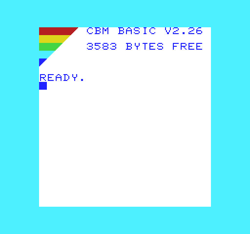
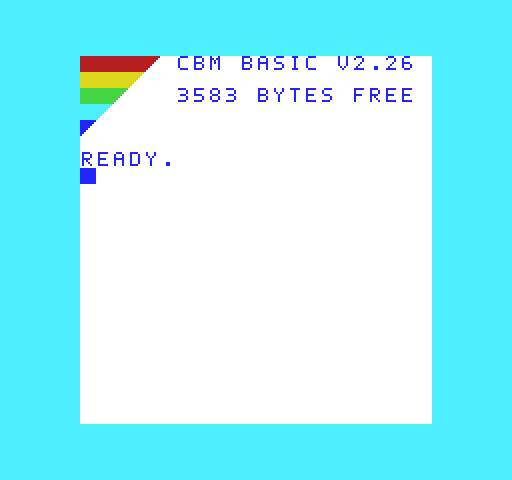

# Optional CHARGEN Fonts

These optional main-repository downloads do not replace the default ROMs. They change the
separate 4096-byte character ROM, not BASIC or KERNAL, and consume no additional
BASIC memory or KERNAL ROM space.

## Designs

- `clean-5x7`: narrower, hand-drawn uppercase letters and digits.
- `compact-5x6`: narrower and shorter letters, with more white space below them.

Each font has two choices: the existing filenames use **striped** uppercase
rainbow tips; filenames ending in `-smooth.bin` preserve the original **smooth**
uppercase tips. Smooth variants are byte-identical to the original downloads
shown in the user's VICE tests. All four remain in the main repository.

Both retain eight-by-eight character cells, 22 screen columns and the existing
startup positions. They change A-Z, 0-9 and the full stop in both character
banks, together with their reverse-video partners. Lowercase letters, all other
punctuation, other PETSCII graphics, spaces, cursor and solid rainbow blocks remain stock.
In the striped variants, uppercase screen code `$69` uses the stock mixed-case diagonal stripe tile,
matching the rainbow tips the user preferred in VICE. Its reverse-video partner
is updated too. This is a full patterned tile rather than a triangular wedge;
the white gaps show the screen background. Its appearance also changes wherever
other software uses that uppercase/graphics character.
The mixed-case font is therefore deliberately unfinished: lowercase remains
the original design.
Smooth variants leave all stock PETSCII graphics untouched. Switching to mixed
case still selects the stock striped tip, regardless of the chosen variant.

## Build And Preview

### Individual Screen Previews

These images render ROM-produced screen RAM, not captured VICE screenshots.

**Stock**

**Clean 5x7**

**Compact 5x6**

[Side-by-side comparison](chargen-comparison.png)

**Original Smooth Tips**

[Smooth-tip side-by-side comparison](chargen/smooth-comparison.png)

### Rebuilding

The stock 901460-03 image is included as `reference/characters.901460-03.bin`,
from <https://www.zimmers.net/anonftp/pub/cbm/firmware/characters/vic20.bin>.
Its SHA256 is `bda280726cfe069ca70ef5e2f2d95a29f69d3950c859a12e6979464963fcf502`.
Build the stable ROM using `node scripts/build.mjs`, install Pillow, then
run `python scripts/play-chargen.py --check-published` to rebuild and verify
the downloadable images byte for byte.
Use `--universal` to preview the universal build instead; this requires its
existing build outputs. Both preview choices produce identical CHARGEN binaries.

Outputs are in `build/chargen/`: four optional `.bin` files, individual screen
previews, `comparison.png`, and `report.json` with hashes and validation details.

The default preview runs the stable PAL ROM's reset instructions using the
existing test RAM map. The optional universal preview uses a static raster,
which triggers the detector's PAL fallback.
It renders the resulting screen and colour RAM using the actual character ROM
bitmaps. RGB values are approximate, and the cursor is shown in its visible
blink phase. This is not a VICE screenshot or an analogue-video simulation.

## Checks And Compatibility

The builder asserts 4096-byte output, restricts modifications to the declared
glyph slots, and checks each changed inverse against its normal character.
The previous versions of both fonts were user-tested at PAL startup in VICE,
with the clean font also shown in mixed-case mode. The updated uppercase striped
tips have not yet been tested in VICE. Neither version has been physically tested;
the screenshots do not establish general software compatibility.

Published files and SHA256 checksums are in `roms/chargen/`. The main README
links directly to all four images. No experimental BASIC/KERNAL pair is required
to use them.

For an emulator experiment, select the desired file as the VIC-20 character ROM;
leave the existing BASIC and KERNAL selections unchanged. Restore stock CHARGEN
to undo the font change. Keep these optional: older software that uses letters
or digits as graphics, reads their bitmaps, or depends on ROM checksums may
look different or behave differently. Unchanged character codes alone do not
prove complete compatibility.
